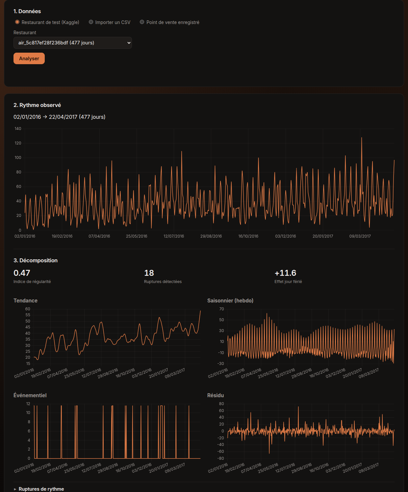
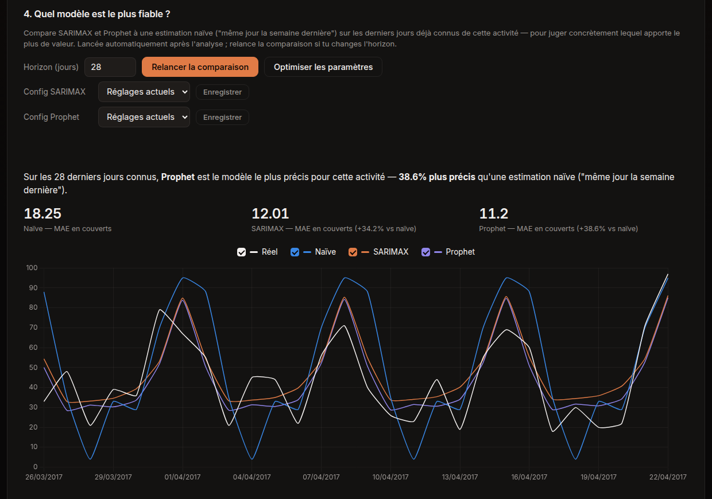

# Cadence

Plateforme web de prévision de rythme d'activité, basée sur l'analyse de séries
temporelles : décomposition du rythme, comparaison de SARIMAX, Prophet et LightGBM,
prévisions en masse et soumissions Kaggle.

> **In English** — Cadence is a web app (FastAPI, plain JavaScript) for daily time-series
> forecasting: it decomposes an activity's rhythm, compares SARIMAX, Prophet and LightGBM
> against a naive baseline, and forecasts in bulk. Its default ensemble (LightGBM + SARIMAX,
> weights learnt per series, FFORMA-style) scores RMSLE 0.40371 on Kaggle *Store Sales*.

[](https://github.com/MichelDM974/Cadence/actions/workflows/ci.yml)

**Meilleurs scores Kaggle officiels**, avec l'ensemble par défaut de l'appli : RMSLE
**0.40371** sur *Store Sales - Time Series Forecasting* et **0.55349** (private) sur
*Recruit Restaurant Visitor Forecasting* (détail plus bas et dans
[BENCHMARKS.md](BENCHMARKS.md)).



## Le concept

Cadence traduit une problématique d'**analyse de séries temporelles** en langage métier : ce que l'utilisateur perçoit intuitivement (rythme hebdomadaire, saisonnalité, pics événementiels) est en réalité un signal temporel structuré, que Cadence décompose, modélise et projette.

## Approche technique

Chaque flux de données client (couverts, CA, etc.) est traité comme une **série temporelle** structurée :

- **Décomposition** : séparation tendance / saisonnalité (hebdo, mensuelle, annuelle) / composante événementielle / résidu — logique proche d'un modèle additif ou multiplicatif type STL
- **Variables exogènes** : intégration de séries temporelles externes (météo, calendrier jours fériés/vacances) comme régresseurs enrichissant la prévision
- **Prévision** : projection du rythme sur un horizon donné, avec intervalle de confiance
- **Détection d'anomalies** : identification des écarts significatifs entre rythme observé et rythme attendu (rupture de série)
- **Indice de régularité** : mesure de la prévisibilité du signal (ex. dispersion résiduelle après décomposition), traduite en score lisible pour l'utilisateur non technique

Généraliste dès le départ : le moteur (décomposition + prévision) et l'import CSV s'adressent à n'importe quel secteur ayant une série temporelle quotidienne (date + valeur numérique). La restauration (prévision de couverts) a servi de premier cas de validation.

## Pile technique

- **Backend** : Python 3.14, FastAPI et uvicorn, pandas, statsmodels (SARIMAX), Prophet,
  LightGBM ; SQLite pour les points de vente et les comptes (mots de passe hachés en
  PBKDF2, tentatives de connexion limitées).
- **Frontend** : pages HTML et JavaScript sans framework, graphiques Chart.js, formules
  KaTeX (page Théorie).
- **Outillage** : versions figées dans `constraints.txt`, image Docker, tests pytest,
  intégration continue sur GitHub Actions.

## Fonctionnalités

- Décomposition du rythme, indice de régularité, alertes de rupture, prévision avec intervalle de confiance, export CSV
- Trois modèles de prévision : SARIMAX et Prophet (comparaison sur une entité, avec backtest contre une baseline naïve), LightGBM (génération en masse multi-entités)
- Variables exogènes mondiales, activables individuellement par l'utilisateur : jours fériés (tous pays), météo (historique réelle + normales saisonnières), vacances scolaires (France, par académie)
- Import CSV multi-entités (jusqu'à 2 dimensions de regroupement, ex. magasin × catégorie), avec génération de prévisions en masse pour toutes les combinaisons
- Variables exogènes personnalisées : colonnes numériques déjà présentes dans le fichier importé, ou un second fichier externe joint automatiquement (série globale ou par entité, y compris valeurs futures réelles)
- Page Kaggle (compétitions de séries temporelles) : train + test (.csv/.zip/.gz) → correspondance de colonnes proposée → backtest local qui rejoue l'horizon réel du test (RMSLE, RMSE, MAE, SMAPE face au naïf saisonnier) → fichier de soumission, par défaut avec l'ensemble LightGBM + SARIMAX, dont la part de chaque modèle est apprise pour chaque série par un méta-modèle (FFORMA) ; historique des essais par compétition, avec les scores Kaggle officiels reportés
- Persistance locale (SQLite) des points de vente/séries analysées, réutilisables sans réimport
- Hyperparamètres des 3 modèles éditables depuis l'interface
- Mode sombre



## Résultats

Détail complet, backtests internes récents et historique → [BENCHMARKS.md](BENCHMARKS.md).

Prototype validé sur données réelles (Kaggle *Recruit Restaurant Visitor Forecasting*, 800+ restaurants, un modèle par restaurant) :

| Configuration | Private RMSLE | Public RMSLE |
|---|---|---|
| Ensemble LightGBM + SARIMAX à poids appris par série (page Kaggle, défaut) | **0.55349** | **0.49911** |
| Ensemble LightGBM + SARIMAX 50/50 | 0.55433 | 0.49971 |
| SARIMAX + jour férié | **0.57956** | **0.51544** |
| SARIMAX seul (aucun exogène) | 0.58205 | 0.51553 |
| SARIMAX + jour férié + météo | 0.59146 | 0.51875 |
| Prophet + jour férié | 0.60576 | 0.55071 |

Et sur *Store Sales - Time Series Forecasting* (54 magasins × 33 catégories, 1782 entités) :

| Configuration | RMSLE |
|---|---|
| Ensemble LightGBM + SARIMAX à poids appris par série (page Kaggle, défaut)* | **0.40371** |
| Ensemble LightGBM + SARIMAX 50/50 | 0.41075 |
| LightGBM seul, page Kaggle | 0.42150 |
| LightGBM, script dédié | 0.42475 |
| SARIMAX seul (aucun exogène) | 0.42726 |
| SARIMAX + `onpromotion` (jointure par entité) | 0.44460 |
| Prophet + `onpromotion` (jointure par entité) | 0.51275 |
| LightGBM + `onpromotion` (jointure par entité, génération en masse) | 0.55166 |

\* meilleur score obtenu à ce jour, en pipeline générique : moyenne pondérée par série (poids prédits par un méta-modèle à arbres à partir de descripteurs de la série, à la FFORMA, appris sur trois backtests antérieurs) d'un LightGBM global (profil « panel homogène » auto-détecté, tweedie 1.5) et de SARIMAX par série, séries éteintes prévues à 0, sans exogène (cf. BENCHMARKS.md). Tendance annuelle (`yoy_trend`) et régularisation sont désormais auto-détectées selon l'hétérogénéité des historiques par entité (2026-09-07, cf. BENCHMARKS.md) ; lags étendus restent opt-in (pas d'amélioration universelle constatée).

(0.501 et 0.37294 respectivement en tête des leaderboards Kaggle, pour référence.) SARIMAX bat par ailleurs une baseline naïve ("même jour la semaine dernière") sur 91% des restaurants testés (amélioration médiane +28,4% sur le MAE).

## Architecture

```
src/
  api.py                  API FastAPI : comptes, analyse, prévisions, page Kaggle
  storage.py              persistance SQLite des points de vente
  exogenous.py            jours fériés, vacances scolaires et météo d'une localisation
  lightgbm_forecast.py    prévision en masse par un modèle global LightGBM
  ensemble_weights.py     part de LightGBM et de SARIMAX apprise pour chaque série (FFORMA)
  kaggle_competition.py   de train.csv + test.csv au fichier de soumission
  create_user.py          création d'un compte en ligne de commande
  benchmark_*.py, forecast_submission_*.py, baseline_comparison.py, decompose_prototype.py
                          bancs d'essai et soumissions Kaggle derrière BENCHMARKS.md
  static/                 pages de l'appli (Prévision, Kaggle, Modèles, Théorie)
tests/                    tests pytest
docs/captures/            captures d'écran du README
.claude/skills/run-cadence/   outillage de l'assistant de code (voir « Méthode »)
```

## Installation

Python 3.14 — même version que l'image Docker et que la CI. Les versions de
toutes les dépendances sont figées dans `constraints.txt`, appliqué partout
avec `-c` : un résultat local est ainsi représentatif de la CI et de l'image.

```
pip install -r requirements.txt -c constraints.txt
cd src && uvicorn api:app
```

Ou avec Docker : `docker compose up --build`, puis http://localhost:8000.

Au premier lancement, la page `/setup` crée le premier compte : la faire avant
d'exposer l'appli sur un réseau. Il n'y a pas d'inscription publique ; les comptes
suivants se créent avec `cd src && python create_user.py <identifiant>`.

Tests (aussi exécutés en CI sur chaque push/PR vers `main`) :

```
pip install -r requirements-dev.txt -c constraints.txt
pytest tests/ -v
```

### Déploiement derrière HTTPS

Poser `CADENCE_HTTPS=1` : le cookie de session prend l'attribut `Secure` et
n'est plus transmis en clair. À ne pas activer en local, où l'app est servie
sur `http://` — le navigateur cesserait d'envoyer le cookie et la connexion
deviendrait impossible.

## Reproduire les benchmarks

Les données Kaggle ne sont pas dans le dépôt (le règlement des compétitions Kaggle en
limite la redistribution) : les télécharger depuis Kaggle, *Recruit Restaurant Visitor
Forecasting* dans `data/raw/` et *Store Sales - Time Series Forecasting* dans le dossier
de la variable `STORE_SALES_DIR`.

- Le plus simple : la page **Kaggle** de l'appli. On y dépose `train.csv` et `test.csv`,
  elle propose la correspondance des colonnes, rejoue l'horizon du test en backtest local,
  puis produit le fichier de soumission.
- Chaque ligne de [BENCHMARKS.md](BENCHMARKS.md) vient d'un script de `src/`
  (`forecast_submission_*.py`, `benchmark_*.py`), qui décrit en tête ce qu'il compare.

## Méthode

Ce projet est développé avec Claude Code, l'assistant de programmation d'Anthropic : il
écrit l'essentiel du code, d'où la mention « Co-Authored-By: Claude » des commits. Mon
travail : définir ce que fait l'appli et pour qui, trancher les choix de conception, fixer
les critères qui valident un changement, et juger les résultats. Par exemple, une piste de
précision n'est retenue que si elle gagne à la fois sur les fenêtres récentes et sur la
même période un an plus tôt, sans dégrader aucun jeu de données connu ; sinon elle reste
une option (voir [BENCHMARKS.md](BENCHMARKS.md)). Le dossier
`.claude/skills/run-cadence/` est l'outillage qui permet à l'assistant de lancer l'appli
sur des données jetables, de la piloter et de la photographier lui-même avant de rendre son
travail. Les numéros #N des messages de commit renvoient à mon suivi de tickets
personnel, qui n'est pas public.

## Licence

Code sous licence MIT (voir [`LICENSE`](LICENSE)). La police Inter, embarquée dans
`src/static/vendor/inter/`, est sous licence SIL Open Font License (voir son
`LICENSE.txt`) ; Chart.js et KaTeX (licence MIT) sont chargés depuis cdnjs.
